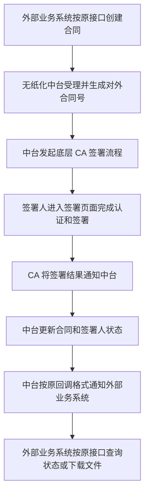
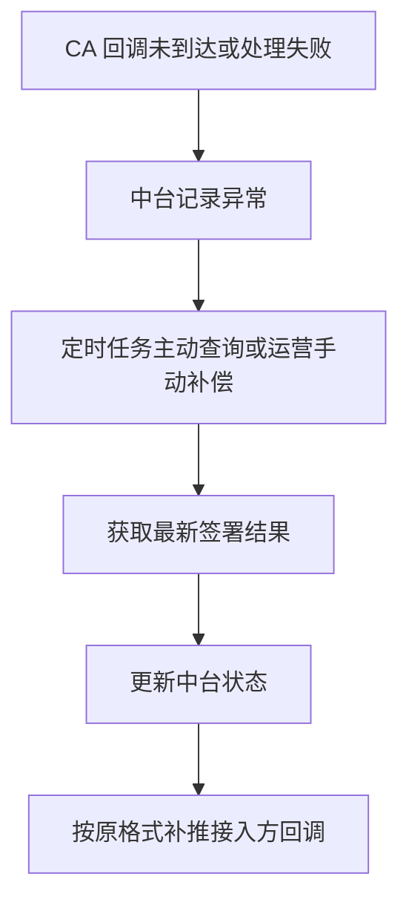

# 无纸化中台 CA 新规适配产品需求文档

| 项目 | 内容 |
|---|---|
| 文档版本 | V1.0 |
| 编写日期 | 2026-07-01 |
| 文档定位 | 产品需求文档 PRD |
| 需求背景 | CA 公司电子签章用章系统升级为 V3.1（新规适配），无纸化中台需在对外服务能力不变的前提下完成底层能力切换 |
| 核心原则 | 外部无感、业务连续、结果一致、异常可追踪 |
| 阅读对象 | 业务负责人、产品经理、项目经理、研发、测试、实施、运维、对接方代表 |

## 一、概述

### 1.1 背景说明

无纸化中台当前已向多个外部业务系统提供标准化服务能力，包括企业/个人认证、电子合同创建、签署状态查询、合同文件下载、合同撤销、拒签、合同验签、印章查询等。外部接入方已经基于《无纸化标准服务能力 V1.6.5》完成对接，并在业务流程中稳定使用。

本次 CA 公司提供新的《电子签章用章系统 接口文档 V3.1（新规适配）》。新版本涉及签章、证书、印章、回调、状态等能力变化。如果直接要求外部接入方按 CA 新接口改造，会带来多方重复开发、联调周期拉长、上线风险增大等问题。

因此，本需求的产品目标不是“让外部系统接入 CA 新接口”，而是“由无纸化中台吸收 CA 新规变化，对外继续提供原有稳定服务能力”。

### 1.2 产品目标

| 目标 | 说明 | 验收口径 |
|---|---|---|
| 对外接口不变 | 外部业务系统继续按现有无纸化接口调用 | 外部接入方无需修改接口地址、请求结构、响应解析和回调处理 |
| 签章链路不断 | 合同创建、签署、查询、下载、验签完整闭环 | 使用旧接口完成一笔新 CA 底层签章业务 |
| 存量业务不受影响 | 已创建合同、历史文件、历史状态可继续查询 | 存量合同查询、下载、验签不因本次切换异常 |
| 异常可解释 | 当 CA 新接口失败或状态不一致时，对外有明确结果 | 对外返回可理解的业务错误，并能在后台定位原因 |
| 可灰度上线 | 支持按业务、接入方或合同类型逐步切换 | 可控制部分业务先走新能力，验证后再扩大范围 |

### 1.3 不做什么

| 不做项 | 说明 |
|---|---|
| 不要求外部接入方改造 CA 新接口 | 外部仍以无纸化中台为唯一对接对象 |
| 不新增一套对外 CA 风格接口 | 本期重点是兼容升级，不做新开放平台 |
| 不改变现有业务合同状态含义 | 对外仍使用原合同状态、签署状态、印章状态 |
| 不重做无纸化全部能力 | 电子材料、电子证照、图像审核等 CA 新文档未覆盖能力保持原逻辑 |

## 二、目标用户与角色

### 2.1 角色说明

| 角色 | 典型诉求 | 本次需求对其影响 |
|---|---|---|
| 外部接入方业务系统 | 希望原接口继续可用，不重新开发 | 理想状态下无感知，仅在异常提示和联调验证上参与 |
| 外部业务办理用户 | 希望合同签署流程能正常完成 | 签署页面、短信/链接、回调结果应保持业务连续 |
| 无纸化平台运营/实施 | 需要知道哪些业务已切换、哪些失败、如何补偿 | 需要可查询、可重推、可人工处理的后台能力 |
| 业务负责人 | 关注上线风险、业务连续性和合规要求 | 需要灰度、回退、成功率和影响范围说明 |
| 测试人员 | 需要明确验收场景与边界 | 需要以业务流程为中心验证，而不是只测接口 |
| 研发人员 | 需要理解产品边界和业务规则 | 研发细节可另写技术方案，PRD 只规定产品行为 |
| CA 对接人员 | 需要确认新规能力和回调规则 | 参与确认签章、证书、印章、拒签等新能力边界 |

### 2.2 用户故事

1. 作为外部接入方，我希望继续调用原无纸化接口创建合同，以便不改造现有业务系统。
2. 作为业务办理用户，我希望签署入口、签署状态和签署结果能正常流转，以便完成合同签署。
3. 作为平台运营人员，我希望能看到合同在新 CA 底层的处理结果，以便处理失败、重推回调和答复业务方。
4. 作为业务负责人，我希望本次切换可以灰度和回退，以便降低对线上业务的影响。
5. 作为测试人员，我希望有清晰的验收清单，以便确认“对外不变”是否真正成立。

## 三、产品范围

### 3.1 本期范围

| 服务能力 | 外部体验要求 | 本期产品要求 |
|---|---|---|
| 获取访问凭证 | 保持原 token 获取方式 | 外部无需感知 CA 应用凭证 |
| 创建电子合同 | 保持原创建合同接口和返回合同号 | 底层完成 CA 新签章流程发起，仍返回原电子合同号 |
| 查询合同/签署状态 | 保持原状态查询接口和状态字典 | 将 CA 签署结果转换为原合同状态和签署状态 |
| 下载合同文件 | 保持返回文件名和文件 Base64 | 底层获取 CA 已签署文件后转换为原格式 |
| 合同验签 | 保持原验签能力 | 将 CA 验签结果转换为原验签结果 |
| 合同撤销 | 保持原撤销入口和结果 | 底层完成 CA 流程撤回或等效处理 |
| 合同拒签 | 保持原拒签结果表达 | 根据 CA 能力确认拒签实现方式，结果仍映射为原拒签状态 |
| 印章查询 | 保持原印章列表字段 | 对 CA 新规字段缺失做兼容处理 |
| 企业/个人认证结果 | 保持原认证结果表达 | 将 CA 证书/认证结果转换为原认证结果 |
| 签署结果回调 | 保持原回调报文 | 中台接收 CA 回调后再按原格式推送接入方 |
| 失败记录查询/补偿 | 保持可定位、可补推 | 新增或复用失败记录能力，支持运营处理 |

### 3.2 暂不纳入本期范围

| 能力 | 原因 | 处理方式 |
|---|---|---|
| 电子材料上传/查询 | CA 新文档未覆盖 | 沿用原能力 |
| 电子证照上传/查询 | CA 新文档未覆盖 | 沿用原能力 |
| 图像审核 | CA 新文档未覆盖 | 沿用原能力 |
| 对外新增 CA 专属接口 | 非本期目标 | 后续如有开放平台规划另立需求 |
| 存量合同迁移 | 风险高且非必要 | 存量按原数据源查询 |

## 四、产品整体流程

### 4.1 合同签署主流程

### 4.2 异常补偿流程

### 4.3 外部感知边界

| 场景 | 外部是否感知 CA 变化 | 产品要求 |
|---|---|---|
| 正常创建合同 | 不感知 | 仍返回原合同号和原响应结构 |
| 正常签署完成 | 不感知 | 仍按原回调格式接收签署结果 |
| 查询签署状态 | 不感知 | 仍看到原合同状态和签署状态 |
| 下载合同文件 | 不感知 | 仍拿到原文件字段 |
| CA 底层异常 | 可感知为业务失败 | 不暴露 CA 内部字段，提示需可解释 |
| 灰度切换 | 不感知 | 同一接入方在灰度范围内结果一致 |

## 五、功能需求

### 5.1 FR-01 对外接口兼容

**需求说明**

无纸化中台对外服务能力保持不变。外部接入方无需理解 CA 新接口，也无需改造现有接口调用逻辑。

**产品规则**

1. 对外接口地址不变。
2. 对外请求参数不要求新增 CA 专属字段。
3. 对外响应结构不变，仍按原 `code/msg/success/data` 结构返回。
4. 对外状态字典不变，合同状态、签署状态、印章状态仍沿用原定义。
5. 对外回调结构不变，接入方原有回调处理逻辑可继续使用。

**验收标准**

| 编号 | 验收项 |
|---|---|
| FR-01-01 | 使用现有接入方请求样例调用，能正常完成鉴权和业务处理 |
| FR-01-02 | 成功响应字段与旧文档一致 |
| FR-01-03 | 失败响应不暴露 CA 内部字段、密钥、堆栈或无法理解的底层错误 |
| FR-01-04 | 接入方无需新增 CA 账号、CA 密钥、CA 回调地址等配置 |

### 5.2 FR-02 创建电子合同

**需求说明**

外部接入方继续按原方式提交合同信息、签署人信息、签章位置/关键字、回调地址。无纸化中台负责在底层完成 CA 新规签章流程发起。

**业务规则**

1. 创建成功后，对外返回原电子合同号。
2. 同一业务流水重复提交时，不应重复创建多份有效合同。
3. 合同文件、签署人、签章位置、签署顺序需与外部传入信息保持一致。
4. 当底层 CA 流程创建失败时，对外返回创建失败，不返回半成品合同。
5. 合同创建成功后，合同初始状态为“待签署”。

**关键字段保持**

| 字段/信息 | 对外要求 |
|---|---|
| 业务关联号 | 保持外部传入值，支持后续查询与排查 |
| 合同名称 | 保持外部传入值 |
| 合同类型 | 保持原合同类型字典 |
| 签署人信息 | 保持原签署人角色和身份关系 |
| 签章位置 | 保持关键字、页码、印章类型等业务含义 |
| 回调地址 | 保持外部传入的回调配置 |

**验收标准**

| 编号 | 验收项 |
|---|---|
| FR-02-01 | 外部通过原创建合同接口可成功创建一笔新 CA 底层合同 |
| FR-02-02 | 返回结果包含原电子合同号和签署过期时间 |
| FR-02-03 | 签署页面展示的合同文件、签署人、签章位置与外部业务预期一致 |
| FR-02-04 | 重复提交同一业务流水时，不产生重复有效签署流程 |

### 5.3 FR-03 签署过程与签署入口

**需求说明**

业务办理用户应能通过现有短信、H5、SDK 或业务页面入口进入签署流程。底层是否使用 CA 新页面或新链接，不应改变业务用户完成签署的核心路径。

**业务规则**

1. 签署入口由中台统一管理，不要求外部业务系统直接拼接 CA 链接。
2. 签署链接过期时，应能给出明确提示，并支持重新获取或重新发起。
3. 多签署人合同需支持并行或按顺序签署，具体以原合同创建参数为准。
4. 企业签章和个人签名需保持原业务含义。
5. 签署完成后，用户返回业务方页面的结果需可识别成功或失败。

**验收标准**

| 编号 | 验收项 |
|---|---|
| FR-03-01 | 个人签署人可完成签署并产生签署成功结果 |
| FR-03-02 | 企业签章场景可选择或使用正确印章 |
| FR-03-03 | 多签署人场景下，未完成、部分完成、全部完成状态准确 |
| FR-03-04 | 签署链接过期或失效时，业务方可获得明确结果 |

### 5.4 FR-04 合同与签署状态查询

**需求说明**

外部接入方继续通过原状态查询能力获取合同状态和签署人状态。中台需将 CA 新规下的签署结果转换为旧状态字典。

**状态字典**

| 状态类型 | 原状态 | 含义 |
|---|---|---|
| 合同状态 | 1 | 待签署 |
| 合同状态 | 2 | 签署中 |
| 合同状态 | 3 | 已完成 |
| 合同状态 | 4 | 已撤销 |
| 合同状态 | 5 | 已过期 |
| 合同状态 | 6 | 已拒绝 |
| 合同状态 | 7 | 已注销 |
| 签署状态 | 1 | 待签章 |
| 签署状态 | 2 | 已签章 |
| 签署状态 | 3 | 已拒签 |
| 签署状态 | 4 | 已撤销 |

**业务规则**

1. 创建合同后，在未有人签署前返回“待签署”。
2. 有部分签署人完成时，合同返回“签署中”。
3. 全部签署人完成时，合同返回“已完成”。
4. 合同撤销后返回“已撤销”。
5. 合同超过有效期后返回“已过期”。
6. 任一关键签署人拒签且业务规则认定合同不可继续时，返回“已拒绝”。

**验收标准**

| 编号 | 验收项 |
|---|---|
| FR-04-01 | 外部查询接口返回原状态字典，不返回 CA 内部状态 |
| FR-04-02 | CA 回调完成后，状态查询能反映最新签署结果 |
| FR-04-03 | 回调未到达时，可通过补偿机制恢复状态 |
| FR-04-04 | 状态流转有日志可追溯 |

### 5.5 FR-05 签署结果回调

**需求说明**

外部接入方仍按原回调格式接收签署结果。中台作为 CA 与接入方之间的回调桥接方，负责接收 CA 结果、转换状态、推送接入方。

**业务规则**

1. CA 回调先进入中台，不直接要求外部接入方接收 CA 回调。
2. 中台确认收到 CA 回调后，更新本地合同状态。
3. 中台按原格式推送接入方回调。
4. 接入方回调失败时，不影响中台对 CA 回调的确认。
5. 接入方回调失败需进入失败记录，支持自动重试和人工补推。

**旧回调信息要求**

| 信息 | 说明 |
|---|---|
| 电子合同号 | 对外合同唯一标识 |
| 合同状态 | 原合同状态字典 |
| 签署人证件号 | 个人签署或企业用印人员 |
| 企业统一社会信用代码 | 企业签章时提供 |
| 签署状态 | 原签署状态字典 |
| 签署时间 | 按原时间格式返回 |

**验收标准**

| 编号 | 验收项 |
|---|---|
| FR-05-01 | CA 签署成功后，接入方收到原格式回调 |
| FR-05-02 | 接入方回调失败时，可查询失败记录 |
| FR-05-03 | 重复回调不会导致业务重复处理 |
| FR-05-04 | 回调推送过程可查询、可重试、可补偿 |

### 5.6 FR-06 合同文件下载与验签

**需求说明**

签署完成后，外部接入方继续按原方式下载合同文件和发起验签。中台负责从底层获取新 CA 签署文件并转换为原输出格式。

**业务规则**

1. 已完成合同可下载签署后的合同文件。
2. 未完成合同如业务规则不允许下载最终文件，应返回明确提示。
3. 文件下载结果保持原 `fileName` 和 `fileBase64` 形式。
4. 验签结果保持原业务判断口径：有效、无效、异常。
5. 文件下载和验签失败时，需保留可排查记录。

**验收标准**

| 编号 | 验收项 |
|---|---|
| FR-06-01 | 签署完成合同可通过原接口下载 PDF 文件 |
| FR-06-02 | 下载文件可正常打开，内容与签署结果一致 |
| FR-06-03 | 原验签接口可返回可理解的验签结果 |
| FR-06-04 | 验签失败时对外返回原错误结构 |

### 5.7 FR-07 合同撤销与拒签

**需求说明**

外部接入方继续按原方式撤销合同或处理拒签。底层 CA 是否提供一一对应能力，不影响对外业务结果表达。

**业务规则**

1. 未完成合同允许撤销，已完成合同不允许撤销。
2. 撤销成功后，合同状态为“已撤销”。
3. 拒签成功后，合同状态为“已拒绝”，拒签人状态为“已拒签”。
4. 如果 CA 无独立拒签接口，需在产品上明确拒签等效处理策略。
5. 撤销/拒签原因需记录，便于业务追溯。

**验收标准**

| 编号 | 验收项 |
|---|---|
| FR-07-01 | 未完成合同可撤销并返回原撤销结果 |
| FR-07-02 | 已完成合同撤销失败且提示明确 |
| FR-07-03 | 拒签后外部查询状态为已拒绝/已拒签 |
| FR-07-04 | 撤销和拒签操作均可追溯到操作来源和时间 |

### 5.8 FR-08 印章查询与新规兼容

**需求说明**

外部接入方继续按原方式查询企业或机构印章。CA 新规下部分字段可能为空或不可返回，中台需保证外部字段兼容。

**业务规则**

1. 可用印章应能正常返回给外部接入方。
2. 印章名称、印章类型、印章图片、有效期、状态等原字段应尽量保持。
3. CA 新规不返回的授权信息，如外部业务依赖，需由中台本地数据补齐或明确不支持范围。
4. CA 新规新增的证书标识等内部字段不默认透出。
5. 印章不可用时，应返回明确状态或不进入可用印章列表。

**验收标准**

| 编号 | 验收项 |
|---|---|
| FR-08-01 | 企业可通过原接口查询可用印章列表 |
| FR-08-02 | 原印章字段不因 CA 字段缺失导致外部解析失败 |
| FR-08-03 | 可用、禁用、注销等状态有明确映射规则 |
| FR-08-04 | 外部依赖印章授权记录时，有明确兼容方案 |

### 5.9 FR-09 运营查询与异常补偿

**需求说明**

由于本次涉及底层能力切换，需提供运营可用的查询和补偿能力，确保业务异常可以被发现、定位和处理。

**后台能力要求**

| 能力 | 说明 |
|---|---|
| 合同链路查询 | 按外部合同号、业务流水号、接入方查询处理状态 |
| 签署状态查询 | 查看每个签署人的当前状态、更新时间、失败原因 |
| 回调记录查询 | 查看 CA 回调和对外回调处理结果 |
| 失败记录重推 | 对外回调失败时支持重推 |
| 状态补偿 | CA 回调丢失时支持主动查询并修复状态 |
| 灰度配置查看 | 查看哪些接入方/业务已切换新 CA 能力 |

**验收标准**

| 编号 | 验收项 |
|---|---|
| FR-09-01 | 运营能通过合同号定位一笔业务的完整处理链路 |
| FR-09-02 | 回调失败记录可查询、可重推 |
| FR-09-03 | 状态不一致时可触发补偿处理 |
| FR-09-04 | 补偿操作有操作日志 |

### 5.10 FR-10 灰度、回退与发布

**需求说明**

为降低风险，本次能力切换需支持灰度发布和回退。产品上必须明确哪些业务先切、怎么判断成功、失败后如何恢复。

**业务规则**

1. 支持按接入方、业务类型、合同类型或平台来源灰度。
2. 灰度期间，同一业务范围内的处理逻辑应保持一致，避免同一接入方结果混乱。
3. 切换失败时，可暂停新建合同进入 CA 新流程。
4. 已进入 CA 新流程的合同需继续完成状态同步，不应简单丢弃。
5. 灰度扩大需基于成功率、回调成功率、投诉/异常数等指标评估。

**验收标准**

| 编号 | 验收项 |
|---|---|
| FR-10-01 | 可指定一类业务先走新 CA 能力 |
| FR-10-02 | 可关闭新建合同进入新 CA 能力 |
| FR-10-03 | 已创建的新 CA 合同仍可查询状态和处理回调 |
| FR-10-04 | 灰度效果有数据可观察 |

## 六、全局规则

### 6.1 状态转换规则

| 业务事件 | 对外合同状态 | 对外签署状态 |
|---|---|---|
| 合同创建成功，尚未签署 | 待签署 | 待签章 |
| 部分签署人完成 | 签署中 | 已签章/待签章 |
| 全部签署人完成 | 已完成 | 已签章 |
| 合同被撤销 | 已撤销 | 已撤销 |
| 合同超过有效期 | 已过期 | 待签章或按最终业务状态 |
| 签署人拒签 | 已拒绝 | 已拒签 |
| 合同被业务注销 | 已注销 | 按注销前状态保留或置为终态 |

### 6.2 异常提示规则

| 异常类型 | 对外提示原则 |
|---|---|
| 外部参数错误 | 明确指出缺少或错误的业务字段 |
| 签署链接失效 | 提示链接已失效，可重新发起或联系业务方 |
| 印章不可用 | 提示无可用印章或印章状态不可用 |
| 合同不可撤销 | 提示合同当前状态不允许撤销 |
| CA 服务不可用 | 提示签章服务暂不可用，建议稍后重试 |
| 回调失败 | 不影响用户签署结果，但进入后台失败记录 |

### 6.3 数据展示与隐私规则

1. 身份证号、手机号、证书信息在后台列表默认脱敏。
2. 文件 Base64、签名值、证书原文不在普通日志或页面直接展示。
3. 对外错误提示不得泄露 CA 密钥、CA 内部接口地址、系统堆栈。
4. 运营后台查看敏感信息需有权限控制和操作日志。

## 七、数据与埋点需求

### 7.1 核心业务指标

| 指标 | 说明 | 目标 |
|---|---|---|
| 外部接入方改造数 | 因本次切换要求外部改造的系统数量 | 0 |
| 合同创建成功率 | 新 CA 底层合同创建成功数 / 创建请求数 | [待确认] 建议不低于 99% |
| 签署完成成功率 | 已完成签署合同数 / 发起签署合同数 | [待确认] |
| 回调成功率 | 成功推送接入方回调数 / 应推送回调数 | [待确认] 建议不低于 99% |
| 状态补偿量 | 需人工或任务补偿的合同数 | 越低越好，需每日监控 |
| 文件下载成功率 | 下载成功次数 / 下载请求次数 | [待确认] |

### 7.2 关键事件记录

| 事件 | 触发时机 | 关键属性 |
|---|---|---|
| 合同创建请求 | 接入方发起创建合同 | 接入方、业务流水、合同类型、是否灰度 |
| 合同创建结果 | 创建成功或失败 | 外部合同号、失败原因、耗时 |
| 签署状态变化 | 签署人状态变化 | 合同号、签署人角色、旧状态、新状态 |
| CA 回调接收 | 收到 CA 回调 | 合同号、回调类型、处理结果 |
| 对外回调推送 | 推送接入方回调 | 接入方、推送结果、重试次数 |
| 文件下载 | 接入方下载合同 | 合同号、文件数量、结果 |
| 人工补偿 | 运营触发补偿 | 操作人、补偿类型、结果 |

## 八、非功能需求

| 类别 | 需求 |
|---|---|
| 可用性 | 新 CA 服务异常时，不影响存量合同查询和下载 |
| 性能 | 状态查询优先返回中台已有状态，避免每次都依赖 CA 实时查询 |
| 安全 | 敏感信息脱敏展示，密钥和证书信息加密保存 |
| 审计 | 创建、撤销、拒签、回调、补偿均需可追溯 |
| 兼容 | 原接入方请求和响应结构保持兼容 |
| 可运维 | 支持灰度、暂停、补偿、重推和异常查询 |

## 九、版本规划

### 9.1 建议分期

| 阶段 | 目标 | 交付范围 |
|---|---|---|
| V1.0 联调版 | 跑通核心合同签署链路 | 创建合同、签署、回调、状态查询、文件下载 |
| V1.1 灰度版 | 支持小范围业务上线 | 灰度配置、失败记录、回调重推、基础监控 |
| V1.2 完整版 | 覆盖印章、拒签、撤销、验签等完整闭环 | 印章兼容、合同撤销/拒签、验签、补偿后台 |
| V1.3 稳定版 | 提升运营和数据能力 | 指标看板、异常分析、批量补偿、告警策略 |

### 9.2 上线准入条件

1. CA 测试环境核心链路联调通过。
2. 至少完成个人签署、企业签章、多签署人、撤销、下载、回调失败重试等场景测试。
3. 明确拒签、印章授权、签署链接有效期等待确认项的处理方案。
4. 运维和实施人员已具备查询与补偿手段。
5. 灰度业务范围、回退策略、上线窗口已确认。

## 十、验收清单

| 场景 | 验收标准 |
|---|---|
| 外部不改造 | 使用旧接口调用，业务可完成 |
| 创建合同 | 返回原合同号，合同进入待签署 |
| 个人签署 | 用户完成签署，状态变为已签章 |
| 企业签章 | 能使用正确企业印章完成签署 |
| 多人签署 | 部分签署和全部签署状态正确 |
| 回调推送 | 接入方收到原格式回调 |
| 回调失败 | 失败记录可查询、可重推 |
| 状态查询 | 返回原状态字典 |
| 文件下载 | 返回原文件字段且文件可打开 |
| 合同验签 | 返回可理解的验签结果 |
| 合同撤销 | 未完成合同可撤销，已完成合同不可撤销 |
| 合同拒签 | 拒签后状态为已拒绝/已拒签 |
| 印章查询 | 原字段兼容，不因新规字段缺失失败 |
| 灰度切换 | 可按指定业务范围启停新能力 |
| 存量合同 | 历史合同查询和下载不受影响 |

## 十一、风险与应对

| 风险 | 影响 | 应对策略 |
|---|---|---|
| CA 新规字段与旧字段无法一一对应 | 外部状态或印章信息不完整 | 建立产品映射规则，无法映射的字段列为待确认 |
| CA 无明确拒签接口 | 旧拒签能力难以完全等价 | 与 CA 确认拒签信号；必要时采用等效业务处理并记录说明 |
| 签署链接有效期短于旧合同有效期 | 用户晚签时链接失效 | 支持重新获取签署入口或重新发起签署 |
| 接入方回调失败 | 外部业务状态不同步 | 失败记录、自动重试、人工补推 |
| 新旧合同并存 | 查询和运营复杂度上升 | 以合同号记录数据来源，查询时自动路由 |
| 灰度范围不清 | 线上结果不一致 | 灰度前明确接入方、业务类型和合同类型范围 |
| 外部误认为需要改造 | 项目推进成本上升 | 提供对外公告：接口不变，仅底层能力升级 |

## 十二、待确认项

### 12.1 必须确认

1. [待确认] CA 新接口下是否存在明确“拒签”接口或回调状态。
2. [待确认] 旧创建合同接口中的合同文件来源是否能稳定映射到 CA 所需文件。
3. [待确认] CA 签署链接有效期与旧合同有效期不一致时，是否允许重新生成签署链接。
4. [待确认] CA 新规下印章授权信息缺失时，旧授权类接口是否由中台本地数据补齐。
5. [待确认] 企业章、个人签名、手写签名分别采用哪种签章方式作为默认策略。
6. [待确认] 对外回调是否必须继续支持旧加密回调。
7. [待确认] 首批灰度接入方、合同类型和上线窗口。

### 12.2 建议确认

1. [待确认] 对外是否需要发布“底层 CA 能力升级，对外接口不变”的通知。
2. [待确认] 合同文件大小上限和下载超时时间。
3. [待确认] 回调失败自动重试次数和重试间隔。
4. [待确认] 运营后台是否已有可复用的失败记录查询和补偿页面。
5. [待确认] 新 CA 能力上线后的成功率、回调率、异常率日报口径。

## 十三、产品评审结论建议

本需求应作为“无纸化中台底层 CA 新规适配”的产品兼容升级项目推进。产品评审时不建议陷入具体加密、签名、字段转换实现细节，而应重点确认以下问题：

1. 外部接入方是否完全无感，哪些情况会被业务方感知。
2. 合同创建、签署、回调、查询、下载、验签是否形成完整闭环。
3. 拒签、印章授权、签署链接过期等新旧能力不一致点如何定义产品规则。
4. 灰度、回退、补偿和运营查询是否足以支撑上线风险。
5. 是否需要对外做接口不变的版本公告和联调说明。

只要上述问题确认清楚，研发侧即可基于本 PRD 另行输出技术方案和接口映射设计。

