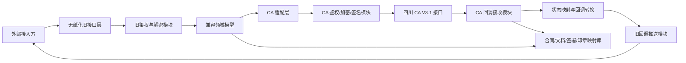

# 无纸化中台 CA 新规接口适配需求文档

| 项目 | 内容 |
|---|---|
| 文档版本 | V1.0 |
| 编写日期 | 2026-07-01 |
| 适配目标 | 对外保持无纸化标准服务能力 V1.6.5 接口不变，内部适配四川 CA 电子签章用章系统 V3.1（新规适配）接口 |
| 资料来源 | 《无纸化标准服务能力V1.6.5.pdf》；《电子签章用章系统 接口文档 V3.1（新规适配）.docx》 |
| 阅读对象 | 产品、研发、测试、运维、对接实施、业务接口调用方 |

## 1. 概述

### 1.1 背景

现有无纸化中台已经对外提供标准服务能力，外部接入方按《无纸化标准服务能力 V1.6.5》调用接口，主要能力包括 token 获取、用户/企业认证、合同创建、签署状态查询、合同文件下载、合同撤销/拒签、合同验签、印章查询与授权、电子材料/证照服务、图像审核等。

本次 CA 公司提供《电子签章用章系统 接口文档 V3.1（新规适配）》作为新的下游接口。新接口在鉴权、签章流程、证书/印章模型、回调确认、文件上传下载、状态字段等方面与现有无纸化对外接口存在差异。

无纸化中台在本次改造中作为中转方，必须保证外部接入方不感知 CA 接口变化，即对外接口地址、请求方式、请求头、请求体、响应结构、状态码、回调入参原则上保持不变；所有差异由中台内部适配层完成转换。

### 1.2 产品目标

1. 保持现有外部接口契约不变，避免外部接入方重新改造。
2. 新增 CA V3.1 适配层，完成旧接口到新接口的鉴权、字段、流程、状态、文件、回调转换。
3. 支持新规下签章、证书、印章查询等能力，保证签署链路可用、可查、可追溯。
4. 建立兼容性、降级、重试、审计与监控机制，降低切换风险。

### 1.3 成功标准

| 维度 | 成功标准 |
|---|---|
| 外部兼容 | 现有接入方无需修改接口地址、请求头、请求体结构、响应解析逻辑即可继续调用 |
| 签章可用 | 通过现有创建合同、查询状态、下载文件、验签等接口可完成 CA 新接口下的签章闭环 |
| 回调兼容 | CA 回调能够被中台接收、确认、转换，并按旧回调格式推送给接入方 |
| 数据一致 | 中台维护旧合同号与 CA docId、flowId、nodeId、bizId、entityId 等标识映射，支持幂等与追溯 |
| 风险可控 | 支持灰度配置、失败重试、异常告警、人工补偿与回退策略 |

## 2. 范围

### 2.1 本期范围

| 模块 | 本期处理策略 |
|---|---|
| 接口鉴权 | 外部仍按无纸化 token + SM2 签名 + params 加密调用；内部转为 CA app-id、timestamp、nonce、signature 体系 |
| 合同创建 | 保持 `/paperless/contract/createContract` 入参与出参不变；内部映射为 CA 文档上传 + 流程签章或异步签章 |
| 签署状态查询 | 保持 `/paperless/contract/contractStatus` 出参；内部基于本地状态表、CA 回调、CA 查询接口综合返回 |
| 合同文件下载 | 保持返回 `fileName/fileBase64`；内部调用 CA 文档下载并转换为 Base64 |
| 合同撤销 | 保持 `/paperless/contract/undoContract`；内部映射 CA 签署撤回接口 |
| 合同拒签 | 保持 `/paperless/contract/rejectSign`；内部优先通过 CA 页面/回调状态识别拒签，必要时按撤回或本地拒签补偿处理 |
| 合同验签 | 保持 `/paperless/contract/contractSignVerify`；内部调用 CA 文档签名验证接口并转换证书/签章信息 |
| 印章列表 | 保持现有印章列表响应；内部调用 CA 印章列表并兼容新规字段缺失 |
| 回调 | 中台接收 CA 回调并返回 `SUCCESS`，再转换为旧格式推送接入方 |
| 配置与审计 | 新增 CA 应用配置、密钥配置、接口映射配置、签署模式配置、审计日志 |

### 2.2 暂不改造范围

| 模块 | 处理说明 |
|---|---|
| 电子材料、电子证照、图像审核 | CA 新接口资料未覆盖，默认沿用现有实现 |
| 前端 SDK 外部 API | 保持现有 SDK 调用方式；如底层签署页面跳转需接入 CA signUrl，由中台 SDK 适配 |
| 已完成历史合同 | 历史合同保持原数据来源；查询、下载按存量标识路由到原实现 |

## 3. 名词说明

| 名词 | 说明 |
|---|---|
| 外部接入方 | 当前调用无纸化标准服务能力的业务系统 |
| 无纸化中台 | 对外提供稳定接口，对内适配 CA 系统的中转系统 |
| CA 系统 | 四川 CA 电子签章用章系统 V3.1 |
| 旧接口 | 无纸化标准服务能力 V1.6.5 中定义的对外接口 |
| 新接口 | CA 电子签章用章系统 V3.1 中定义的接口 |
| 兼容适配层 | 中台内部新增模块，负责旧接口与新接口的协议转换、数据映射、状态同步 |
| elecContractNo | 无纸化中台对外返回的电子合同号 |
| docId | CA 上传文档后返回的文档 ID |
| flowId | CA 流程签章 ID |
| nodeId | CA 单次签署节点 ID |
| entityId | CA 证书标识，新规下印章/证书关联的重要标识 |

## 4. 总体方案

### 4.1 设计原则

1. 外部契约不变：所有旧接口的 URL、HTTP Method、请求头、请求体、响应体、状态码语义保持兼容。
2. 内部模型解耦：先将旧接口请求解密并转换为中台统一领域模型，再由 CA 适配器转换为 CA 请求。
3. 状态以中台为准：中台保存合同、签署人、文档、印章、回调、CA 标识映射，以便旧接口查询时稳定返回。
4. 异步回调可补偿：CA 回调失败或接入方回调失败时，中台支持主动查询、重试、补偿推送。
5. 配置驱动：CA 鉴权方式、签署模式、签章方式、环境地址、回调地址、灰度范围通过配置管理。

### 4.2 架构方案



### 4.3 核心处理链路

1. 外部接入方按旧方式获取 token。
2. 外部接入方按旧接口传入 `token/requestId/timestamp/signature` 请求头和 `params` 加密请求体。
3. 中台完成旧鉴权、验签、解密、幂等校验。
4. 中台转换为统一领域模型，例如合同、签署人、文件、签章位置、回调配置。
5. CA 适配层按配置选择 CA 接口和签署模式，生成 CA 请求头、签名、加密体。
6. CA 返回后，中台记录 CA 标识映射，并转换为旧接口响应。
7. CA 异步回调到中台，中台返回 `SUCCESS` 确认接收，更新本地状态。
8. 中台按旧回调数据结构推送给接入方，并记录推送结果。

## 5. 关键差异与适配策略

### 5.1 鉴权差异

| 项目 | 旧无纸化接口 | CA V3.1 接口 | 适配要求 |
|---|---|---|---|
| 应用身份 | `app_id/app_secret/username/password/grant_type` 获取 token | CA 分配 `APP_ID/APP_SECRET` | 外部 token 机制保留；CA 凭据仅中台内部使用 |
| 业务请求头 | `token/requestId/timestamp/signature` | `app-id/timestamp/nonce/signature`，SM2-CBC 时另有 `cbckey/cbciv` | 中台验证旧请求头后，重新生成 CA 请求头 |
| 签名原文 | 业务参数 JSON 的 MD5 大写 + `#` + timestamp，再 SM2 加签 | JSON 为请求体字符串 + nonce + timestamp；表单按参数值排序拼接 + nonce + timestamp | 建立 `CaSignatureService` 统一处理 |
| 请求加密 | 旧业务参数 SM2 加密后放入 `params` | 支持 HMAC、HMAC-CBC、SM2-CBC、wrap 等模式 | [待确认] 本期采用的 CA 鉴权模式；建议生产优先 SM2-CBC |
| 防重放 | 旧接口依赖 requestId、timestamp、signature | CA 要求 nonce 在 3-5 分钟内唯一 | 中台维护旧 requestId 幂等和 CA nonce 缓存 |

### 5.2 响应差异

| 项目 | 旧无纸化接口 | CA V3.1 接口 | 适配要求 |
|---|---|---|---|
| 成功码 | `code=200`，`success=true` | `result_code=0`，`success=true` | CA 成功统一转换为旧 `code=200` |
| 失败码 | `401/403/500` 等 | `result_code != 0` | 建立错误码映射表，无法识别时返回旧 `500` 并保留内部错误明细 |
| 数据字段 | `data` | `body` | `body` 转换为旧 `data` |
| 文件下载 | 旧接口返回 `fileBase64` | CA 可返回文件流或 JSON 包装 | 中台将文件流转为 Base64 后按旧格式返回 |

### 5.3 签章流程差异

| 项目 | 旧无纸化接口 | CA V3.1 接口 | 适配要求 |
|---|---|---|---|
| 创建合同 | 一次性传合同、签署人、关键字、回调地址，返回 `elecContractNo/expireTime` | 流程签章需先上传文档获取 `docId`，再文档签署获取 `flowId/nodeId/signUrl`；异步签章可传 `fileBase64` | 中台内部拆分为多步 CA 调用，对外仍一次返回旧合同号 |
| 签章定位 | 旧接口主要按关键字和页码范围 | CA 支持关键字签章和坐标签章，坐标为 0-1 比例 | 关键字优先映射；坐标签署作为扩展能力，旧接口无字段时不暴露 |
| 签署模式 | 旧接口通过签署人、企业、短信通知等字段表达 | CA 使用 `signModel/certModel/signType/signatoryType` | 按签署人类型和配置生成默认签署模式 |
| 新规签章技术 | 旧接口未显式区分 GB38540 与 pureImg | CA 支持 `GB38540` 和 `pureImg`，同一文档多次签署必须保持同一签署方式 | [待确认] 默认签章技术类型；建议企业章默认 GB38540，手写签名默认 pureImg |
| 签署链接 | 旧创建合同不返回签署链接 | CA 页面签署返回 `signUrl` | 中台可用于短信/SDK/H5 内部跳转，不改变旧创建合同响应 |

### 5.4 证书与印章差异

| 项目 | 旧无纸化接口 | CA V3.1 接口 | 适配要求 |
|---|---|---|---|
| 证书模型 | 旧接口主要围绕实名认证、企业认证、印章权限 | CA 新增云证书、一次性证书、证书 `entityId` | 中台维护用户/企业/印章与 `entityId` 的映射 |
| 印章列表 | 旧接口返回 `sealId/sealName/sealType/sealImage/sealStatus/auths` 等 | CA 返回 `sealId/sealName/sealProfile/sealType/status/entityId` 等 | 字段转换：`sealProfile -> sealImage`；`status -> sealStatus` |
| 新规字段 | 旧接口无 `entityId` | CA 新规印章独有 `entityId` | 中台保存，不默认透出给旧接口 |
| 字段缺失 | 旧接口可能依赖授权信息 `auths` | CA 新规 `auths` 无此字段，`sealTypeName` 为 null | [待确认] 旧授权类接口是否仍需完整支持；若需要，需由中台本地授权表补齐 |
| 印章状态 | 旧状态包括 `save/apply/nopass/pass/expire/cancel/refund/refunded` | CA 新规只能查询 `usable/disabled` 两种状态 | 建立状态映射，无法表达的旧状态需本地保存或返回兼容默认值 |

### 5.5 回调差异

| 项目 | 旧无纸化接口 | CA V3.1 接口 | 适配要求 |
|---|---|---|---|
| 合同签署回调 | 接入方提供地址，中台推送 `elecContractNo/contractStatus/idCardNo/socialCreditCode/signStatus/signTime` | CA 回调到业务系统自定义地址，要求返回字符串 `SUCCESS` | 中台作为 CA 回调接收方，确认后再转换推送旧回调 |
| 回调重试 | 旧接口由接入方提供响应规则 | CA 失败默认重试一次，具体策略依配置 | 中台需自行维护对外回调重试队列 |
| 回调鉴权 | 旧回调支持是否加密传输配置 | CA 回调请求鉴权模式同业务系统接入采用的一致 | 中台验 CA 回调签名，再按旧配置对外加密/明文推送 |

## 6. 外部接口兼容清单

### 6.1 鉴权与通用接口

| 旧接口 | 保持策略 | 内部处理 |
|---|---|---|
| `POST /auth/oauth/token` | 完全保持 | 仍由中台签发旧 token；不暴露 CA APP_ID/APP_SECRET |
| 所有旧业务接口请求头 | 完全保持 | 验证 `token/requestId/timestamp/signature` 后，生成 CA 请求头 |
| 所有旧业务接口请求体 | 完全保持 | 解密 `params` 得到旧业务 JSON，再转换 |
| 所有旧业务接口响应 | 完全保持 | CA `result_code/body` 转换为旧 `code/msg/success/data` |

### 6.2 合同签章接口映射

| 旧接口 | 旧能力 | CA 目标接口 | 适配说明 |
|---|---|---|---|
| `/paperless/contract/createContract` | 创建电子合同 | `/api/open/v2/docs/upload` + `/api/open/v2/flow/docSign` 或 `/api/open/v3/asyncDocSign` | 默认采用流程签章，先上传文件再发起签署；若业务场景为单文件异步盖章，可配置走异步签章 |
| `/paperless/contract/contractStatus` | 查询签署人签署状态 | 本地状态表 + CA 回调 + `/api/open/v3/asyncDocSign/query` | 对外返回旧 `contractStatus/signStatus/signTime` |
| `/paperless/contract/downloadContractFileByNo` | 获取电子合同文件 | `/api/open/v2/docs/download` | CA 文件流转 Base64，保持旧 `fileName/fileBase64` |
| `/paperless/contract/undoContract` | 撤销电子合同 | `/api/open/v2/flow/docSignRevoke` | 旧 `elecContractNo` 映射 `flowId/nodeId/docIds` |
| `/paperless/contract/rejectSign` | 电子合同拒签 | CA 页面回调状态或中台本地拒签补偿 | [待确认] CA 是否提供明确拒签接口；若无，需通过签署页失败/撤回实现 |
| `/paperless/contract/contractSignVerify` | 电子合同验证 | `/api/open/v2/docs/verify` | CA 验签结果转换为旧证书与签章验证结构 |
| `/paperless/contract/getContractList` | 获取合同列表 | 本地合同表 | 新 CA 标识写入本地表，对外按旧分页与筛选返回 |
| `/paperless/contract/contractInfo` | 获取合同信息 | 本地合同表 + CA 文档状态 | 旧字段由本地合同、签署人、文档映射表组装 |
| `/paperless/contract/queryPushFailLog` | 查询推送失败记录 | 中台回调日志表 | 不依赖 CA，由中台记录对外回调失败 |

### 6.3 企业、证书、印章接口映射

| 旧接口 | 旧能力 | CA 目标接口 | 适配说明 |
|---|---|---|---|
| `/paperless/enterprise/enterpriseAuth` | 获取企业实名认证二维码 | `/api/v2/certification/cert/fetchPageUrl` | 机构证书场景映射为 CA 证书业务链接，返回旧二维码/URL 字段 |
| `/paperless/enterprise/checkEnterpriseAuth` | 查询企业认证结果 | `/api/v2/certification/cert/queryByEntityId` + 本地认证记录 | 旧 `authResult/authTime/authLevel` 由本地和 CA 证书状态转换 |
| `/paperless/seal/entAllSealList` | 查询企业所有印章列表 | `/api/open/v2/seal/listSeal` | 传 `creditCode/cardNo` 查询；转换为旧 `sealList` |
| `/paperless/seal/sealList` | 获取机构印章列表 | `/api/open/v2/seal/listSeal` | 新规 `sealTypeName=null/auths` 缺失时由中台补齐或返回兼容默认 |
| `/paperless/seal/addAuth` | 新增印章权限 | [待确认] CA 文档未明确提供 | 若 CA 无授权接口，本期需走中台本地授权控制或暂不支持下发至 CA |
| `/paperless/seal/delSealAuth` | 删除印章授权 | [待确认] CA 文档未明确提供 | 同上 |
| `/paperless/seal/sealAuthList` | 获取印章授权记录 | [待确认] CA 新规 `auths` 无此字段 | 建议由中台本地授权表返回旧格式 |
| `/paperless/seal/sealUseList` | 获取印章使用记录 | 本地签署日志 | CA 文档未覆盖，建议由中台签署日志生成 |
| `/paperless/enterprise/syncEnterpriseInfo` | 同步企业信息 | 中台本地企业信息维护 | 不直接依赖 CA；必要时同步到证书/印章映射 |
| `/paperless/enterprise/changeEnterpriseInfo` | 变更企业信息 | 中台本地企业信息维护 | 不直接依赖 CA；证书侧变更需另行确认 CA 对应接口 |

### 6.4 非 CA 覆盖接口

| 旧接口 | 处理策略 |
|---|---|
| `/paperless/elecMaterial/uploadElecMaterial` | 保持现有实现 |
| `/paperless/elecMaterial/checkElecMaterial` | 保持现有实现 |
| `/paperless/BSInterface/uploadElecTestifyFile` | 保持现有实现 |
| `/paperless/BSInterface/getElecTestify` | 保持现有实现 |
| `/paperless/examine/imageExamine` | 保持现有实现 |

## 7. 功能需求

### 7.1 FR-01 旧接口兼容网关

**用户故事**：作为外部接入方，我希望继续按旧接口调用无纸化中台，以便不修改已有系统。

**需求描述**：

1. 所有旧接口 URL、HTTP Method、Content-Type、请求头、请求体、响应体保持兼容。
2. 保留旧 token 获取逻辑，token 默认有效期仍为 24 小时。
3. 保留旧业务请求头 `token/requestId/timestamp/signature`。
4. 保留旧业务请求体 `params` 加密传输方式。
5. 旧接口响应保持 `code/msg/success/data`。
6. 旧接口状态字典保持：
   - 系统响应：`200` 请求成功，`401` 认证失败，`403` 无权限，`500` 系统内部错误。
   - 合同状态：`1` 待签署，`2` 签署中，`3` 已完成，`4` 已撤销，`5` 已过期，`6` 已拒绝，`7` 已注销。
   - 签章状态：`1` 待签章，`2` 已签章，`3` 已拒签，`4` 已撤销。

**验收标准**：

1. 使用旧文档中的请求示例调用，接口能够正常鉴权、解密、返回旧格式。
2. 外部接入方不传 CA 新增字段时，不影响旧接口调用。
3. CA 返回失败时，旧接口不暴露 CA 内部字段名、密钥、原始错误栈。

### 7.2 FR-02 CA 鉴权与密钥管理

**用户故事**：作为中台系统，我需要安全调用 CA 新接口，以便满足新规接口鉴权要求。

**需求描述**：

1. 支持 CA `APP_ID/APP_SECRET` 配置管理。
2. 支持生成 CA 公共请求头：`app-id/timestamp/nonce/signature`。
3. 支持 CA HMAC、HMAC-CBC、SM2-CBC、wrap 类鉴权模式的可配置扩展。
4. nonce 长度与唯一性满足 CA 要求，3-5 分钟内不重复。
5. 对 CA 密钥、SM2 私钥、SM4 密钥、初始化向量等敏感配置加密存储。
6. 记录每次 CA 调用的 requestId、nonce、timestamp、接口名、耗时、结果。

**验收标准**：

1. CA 测试环境接口能通过配置完成鉴权。
2. 重放同一 nonce 的请求不会由中台重复发起。
3. 日志中不出现明文 APP_SECRET、私钥、证件号完整值、手机号完整值。

### 7.3 FR-03 合同创建适配

**用户故事**：作为外部接入方，我希望继续调用创建电子合同接口，以便生成可签署合同。

**需求描述**：

1. 接收旧 `createContract` 入参，包括 `bizFileId/contractName/contractType/starterName/starterIdCardNo/starterPhoneNumber/starterEnterpriseName/socialCreditCode/expireTime/contractFile/contractReceiver/certificateOrg/callbackUrl/platformCode`。
2. 对每个 `contractFile`：
   - 校验 `fileName/sha1Hash/attachment/contractSignCfg`。
   - 将旧文件参数解析为 CA 可用文件。若旧接口仅传文件参数名和 hash，中台需从已有文件上传链路或请求上下文获取实际 PDF 文件。[待确认]
   - 调用 CA `/api/open/v2/docs/upload`，获取 `docId`。
3. 将旧 `contractSignCfg` 转换为 CA `signConfigs`：
   - `keywords -> keywordsSignParams.keyword`。
   - `pageRange` 转换为 `pageNo/pageConfigList`。
   - `sealType` 转换为 CA 印章类型。
   - `role` 关联旧 `contractReceiver`。
4. 将旧签署人转换为 CA `user/enterprise/signatoryType`。
5. 按配置选择：
   - 企业/个人已有印章签署：`signModel=webFree` 或 `h5Free`，`certModel=sealCert`。
   - 个人手写签名：`signModel=h5Write`，`certModel=senceCert` 或 `cloudCert`。
   - 签章技术：默认 `GB38540`，手写签名可用 `pureImg`。[待确认]
6. CA 返回 `flowId/nodeId/docIds/signUrl` 后，中台生成或沿用旧 `elecContractNo`，保存映射。
7. 旧接口仍返回：

```json
{
  "code": 200,
  "msg": "请求成功",
  "success": true,
  "data": {
    "elecContractNo": "旧电子合同号",
    "expireTime": "yyyy-MM-dd HH:mm:ss"
  }
}
```

**验收标准**：

1. 同一个 `bizFileId` 重复请求不得重复创建 CA 流程，应返回已创建的旧 `elecContractNo`。
2. 签署关键字、页码、角色、签署顺序在 CA 签署页面中正确生效。
3. 外部响应不包含 `docId/flowId/nodeId/signUrl`，除非后续明确扩展旧接口。

### 7.4 FR-04 签署状态同步与查询

**用户故事**：作为外部接入方，我希望继续查询合同和签署人的状态，以便驱动业务流程。

**需求描述**：

1. 中台维护合同状态机：
   - 创建成功：旧合同状态 `1` 待签署。
   - 任一签署节点开始或部分完成：旧合同状态 `2` 签署中。
   - 全部签署成功：旧合同状态 `3` 已完成。
   - CA 撤回成功：旧合同状态 `4` 已撤销。
   - 超过旧 `expireTime` 或 CA 链接/流程过期：旧合同状态 `5` 已过期。
   - CA 回调明确签署失败且原因识别为拒绝：旧合同状态 `6` 已拒绝。
   - 旧业务注销类合同联动完成：旧合同状态 `7` 已注销。
2. 中台维护签署人状态机：
   - 未签：`1` 待签章。
   - CA 回调 `signSuccess=true`：`2` 已签章。
   - 用户拒签或页面失败映射为拒签：`3` 已拒签。
   - 流程撤回：`4` 已撤销。
3. 旧 `/contractStatus` 查询优先读中台本地状态；本地无终态且回调超时时，可主动查询 CA。
4. 查询返回字段保持 `elecContractNo/bizFileId/contractName/contractStatus/expireTime/personName/signStatus/signTime` 等旧结构。

**验收标准**：

1. CA 回调成功后，旧状态查询接口 5 秒内可查询到最新状态。[待确认 SLA]
2. CA 回调丢失时，通过主动查询或补偿任务可恢复状态。
3. 状态字典不向外暴露 CA `signSuccess/SIGN_SUCCESS/SIGN_ERROR` 等内部枚举。

### 7.5 FR-05 文件下载与验签

**用户故事**：作为外部接入方，我希望继续通过旧合同号下载签署后的合同文件并验证签名。

**需求描述**：

1. `/downloadContractFileByNo` 接收旧 `elecContractNo/idCardNo/socialCreditCode`。
2. 中台根据 `elecContractNo` 查询 `docId/flowId/nodeId`。
3. 调用 CA `/api/open/v2/docs/download`：
   - 成功响应为文件流时，转为 Base64。
   - 失败响应为 JSON 时，转换为旧错误响应。
4. 旧接口返回 `data` 数组，元素包含 `fileName/fileBase64`。
5. `/contractSignVerify` 调用 CA `/api/open/v2/docs/verify`，将 `VerifyResult/CertInfo/SignInfo` 转换为旧验签字段。

**验收标准**：

1. 下载结果可还原为完整 PDF 文件。
2. 验签失败时返回旧 `code/msg/success=false`，并记录 CA 原始验签结果。
3. 大文件下载有超时、大小限制和审计记录。[待确认文件大小上限]

### 7.6 FR-06 撤销与拒签

**用户故事**：作为外部接入方，我希望继续撤销或拒签合同，以便处理业务异常。

**需求描述**：

1. `/undoContract` 保持旧入参 `elecContractNo/idCardNo/socialCreditCode/undoReason`。
2. 中台校验合同未完成、未撤销、未注销。
3. 调用 CA `/api/open/v2/flow/docSignRevoke`，传入 `flowId/nodeId/docIds/reason`。
4. 撤销成功后返回旧 `elecContractNo/undoTime`。
5. `/rejectSign` 保持旧接口：
   - 若 CA 页面回调提供拒签状态，按拒签处理。
   - 若 CA 无明确拒签接口，中台可将拒签转为签署节点撤回并标记旧状态为 `6` 已拒绝。[待确认]

**验收标准**：

1. 已完成合同撤销失败，返回旧格式错误。
2. 撤销成功后，旧状态查询返回 `contractStatus=4`。
3. 拒签成功后，旧状态查询返回 `contractStatus=6`，拒签人 `signStatus=3`。

### 7.7 FR-07 印章列表与新规字段兼容

**用户故事**：作为外部接入方，我希望继续按旧字段获取企业/机构印章列表，以便选择或校验可用印章。

**需求描述**：

1. `/entAllSealList` 和 `/sealList` 调用 CA `/api/open/v2/seal/listSeal`。
2. 旧入参 `socialCreditCode/idCardNo/id` 转换为 CA `creditCode/cardNo/sealIds`。
3. 旧印章类型保持数字编码：公章 1、财务章 2、发票章 3、合同章 4、法人章 5、其他 6。
4. CA `sealProfile` 转换为旧 `sealImage`。
5. CA `usable` 转换为旧 `pass`；`disabled` 转换为旧 `cancel` 或不可用状态。[待确认]
6. CA 新规缺失的 `auths`、`sealTypeName`：
   - `sealTypeName` 可按 `sealType` 本地字典补齐。
   - `auths` 若旧接口调用方依赖，由中台本地授权表补齐。
7. CA 新规独有 `entityId` 保存到本地映射，不默认出现在旧响应。

**验收标准**：

1. 旧响应字段完整，不因 CA 字段为空导致调用方解析失败。
2. 查询可用印章时只返回中台判定可用的印章。
3. 新规下不可查询的历史状态有明确兼容策略。

### 7.8 FR-08 证书与企业认证适配

**用户故事**：作为外部接入方，我希望企业认证和证书状态仍可通过旧接口完成，以便继续使用印章和签章能力。

**需求描述**：

1. 企业认证二维码/URL 类接口可映射 CA 获取证书业务链接。
2. CA 证书申请返回或回调中的 `entityId` 与旧企业、法人、管理员、印章建立映射。
3. 查询企业认证结果时，将 CA 证书状态转换为旧 `authResult/authTime/authLevel`。
4. 旧 `authLevel` 默认维持 L4 语义，除非 CA 回传更精确级别。[待确认]

**验收标准**：

1. 企业完成 CA 证书业务后，旧查询接口返回认证通过。
2. `entityId` 缺失时，不允许发起依赖证书的签章请求，并返回旧格式错误。
3. 法人、管理员、用印人身份信息匹配失败时，阻断签章并记录审计。

### 7.9 FR-09 回调桥接

**用户故事**：作为外部接入方，我希望仍按旧回调格式接收签署结果，以便不修改业务处理逻辑。

**需求描述**：

1. 中台提供 CA 回调接收地址，作为 CA `notifyUrl` 或流程签署回调地址。
2. 收到 CA 回调后：
   - 验证 CA 请求鉴权。
   - 校验 `flowId/nodeId/docIds` 与本地映射。
   - 落库原始回调和转换后的状态。
   - 立即向 CA 返回 `SUCCESS`。
3. 中台异步推送旧格式回调给接入方：

```json
{
  "elecContractNo": "旧电子合同号",
  "contractStatus": "2",
  "idCardNo": "签署人证件号",
  "socialCreditCode": "企业统一社会信用代码",
  "signStatus": "2",
  "signTime": "yyyy-MM-dd HH:mm:ss"
}
```

4. 支持旧 `callbackUrl` 中 `isEncrypt/publicKey/type` 配置。
5. 对外回调失败进入重试队列，支持查询失败记录。

**验收标准**：

1. CA 回调接口返回 `SUCCESS` 的时机不依赖接入方回调是否成功。
2. 接入方回调失败时，可通过旧查询推送失败记录接口查到。
3. 同一 CA 回调重复到达时，不重复推动业务终态。

### 7.10 FR-10 配置、灰度与回退

**用户故事**：作为运维/实施人员，我希望按接入方、环境、业务类型灰度切换 CA 新接口，以便降低上线风险。

**需求描述**：

1. 支持按 `app_id/platformCode/contractType/certificateOrg` 配置是否走 CA 新适配。
2. 支持 CA 测试地址、本地部署地址、生产地址配置。
3. 支持按接口维度启停适配，例如仅先启用印章列表、再启用合同创建。
4. 支持回退到旧实现或阻断新建合同，不影响存量合同查询下载。
5. 所有配置变更记录操作人、时间、变更前后值。

**验收标准**：

1. 灰度配置生效无需发版。[待确认是否已有配置中心]
2. 关闭 CA 适配后，未完成 CA 流程的合同仍能查询本地状态并提示明确。
3. 配置错误时有启动校验和运行期告警。

## 8. 数据模型需求

### 8.1 CA 标识映射表

| 字段 | 类型 | 必填 | 说明 |
|---|---|---|---|
| id | String | 是 | 主键 |
| appId | String | 是 | 外部接入方 app_id |
| requestId | String | 是 | 旧请求唯一 ID |
| bizFileId | String | 是 | 外部业务关联号 |
| elecContractNo | String | 是 | 对外电子合同号 |
| caBizId | String | 否 | CA 异步签章业务标识 |
| caDocIds | JSON | 否 | CA 文档 ID 列表 |
| caFlowId | Long | 否 | CA 流程 ID |
| caNodeIds | JSON | 否 | CA 节点 ID 列表 |
| caSignUrl | String | 否 | CA 签署链接，内部使用 |
| entityId | String | 否 | CA 证书标识 |
| signType | String | 否 | GB38540 或 pureImg |
| signModel | String | 否 | webFree、h5Write、h5Free |
| status | Integer | 是 | 旧合同状态 |
| createdAt | DateTime | 是 | 创建时间 |
| updatedAt | DateTime | 是 | 更新时间 |

### 8.2 签署人映射表

| 字段 | 类型 | 必填 | 说明 |
|---|---|---|---|
| elecContractNo | String | 是 | 旧电子合同号 |
| role | String | 是 | 旧签署人角色 |
| personName | String | 否 | 签署人姓名 |
| idCardNoHash | String | 否 | 身份证 hash |
| phoneHash | String | 否 | 手机号 hash |
| enterpriseName | String | 否 | 企业名称 |
| socialCreditCode | String | 否 | 统一社会信用代码 |
| caNodeId | Long | 否 | CA 节点 ID |
| caEntityId | String | 否 | CA 证书标识 |
| signStatus | Integer | 是 | 旧签章状态 |
| signTime | DateTime | 否 | 签署时间 |

### 8.3 回调日志表

| 字段 | 类型 | 必填 | 说明 |
|---|---|---|---|
| callbackId | String | 是 | 回调记录 ID |
| source | String | 是 | CA 或 OUTER |
| elecContractNo | String | 是 | 旧电子合同号 |
| caFlowId | Long | 否 | CA 流程 ID |
| rawPayload | Text | 是 | 原始回调内容，敏感信息脱敏或加密 |
| mappedPayload | Text | 否 | 转换后的旧回调内容 |
| ackStatus | String | 否 | 对 CA 的确认结果 |
| pushStatus | String | 否 | 对外推送结果 |
| retryCount | Integer | 是 | 重试次数 |
| nextRetryAt | DateTime | 否 | 下次重试时间 |

## 9. 状态与字段映射

### 9.1 合同状态映射

| 旧状态 | 旧含义 | CA 信号 | 适配规则 |
|---|---|---|---|
| 1 | 待签署 | 创建流程成功，未收到签署成功回调 | 合同创建成功后初始状态 |
| 2 | 签署中 | 部分节点签署成功，或签署链接已生成 | 任一签署人完成但未全部完成 |
| 3 | 已完成 | 所有签署节点 `signSuccess=true` | 全部签署人完成 |
| 4 | 已撤销 | `docSignRevoke` 成功 | 撤销接口成功或 CA 撤回事件 |
| 5 | 已过期 | 超过旧 `expireTime` 或 CA 链接/流程过期 | 定时任务扫描更新 |
| 6 | 已拒绝 | CA 页面/回调失败且原因识别为用户拒绝 | [待确认] CA 拒签信号 |
| 7 | 已注销 | 旧业务注销逻辑触发 | 由中台业务规则维护 |

### 9.2 签章状态映射

| 旧状态 | 旧含义 | CA 信号 | 适配规则 |
|---|---|---|---|
| 1 | 待签章 | 节点未完成 | 默认状态 |
| 2 | 已签章 | `signSuccess=true` | 回填 `signTime` |
| 3 | 已拒签 | 用户拒绝签署 | [待确认] 由 CA 失败原因映射 |
| 4 | 已撤销 | 节点撤回 | 撤销流程后更新 |

### 9.3 印章状态映射

| CA 状态 | 旧状态建议 | 说明 |
|---|---|---|
| usable | pass | 可用印章 |
| disabled | cancel | 不可用印章，[待确认] 是否映射为 `cancel` 或本地禁用态 |
| revoked | cancel | CA 文档列出但新规不能查到 |
| sysrevoked | cancel | CA 文档列出但新规不能查到 |
| 无 CA 数据 | 本地旧状态 | `save/apply/nopass/expire/refund/refunded` 等需由本地表维护 |

## 10. 非功能需求

### 10.1 安全与合规

1. CA 密钥、旧 SM2 私钥、公钥、APP_SECRET 均需加密存储。
2. 日志、监控、异常信息中身份证号、手机号、证书、签名值、文件 Base64 必须脱敏。
3. 文件传输全链路使用 HTTPS。
4. 回调地址需支持白名单、签名校验、防重放。
5. 文件、证书、签署日志需按业务合规要求留存。[待确认留存周期]

### 10.2 性能

| 场景 | 指标 |
|---|---|
| 旧接口鉴权与解密 | P95 <= 300ms，不含 CA 调用 |
| 创建合同同步返回 | P95 <= 5s；多文件场景可配置更长超时 |
| 状态查询 | P95 <= 500ms，优先读本地状态 |
| 文件下载 | 支持大文件流式处理，Base64 转换不造成内存溢出 |

### 10.3 可靠性

1. CA 调用失败需有明确错误映射、重试策略和告警。
2. CA 回调与对外回调分离，避免外部接入方故障影响 CA 回调确认。
3. 所有创建、撤销、回调处理均需幂等。
4. 支持补偿任务：
   - 查询未收到回调的 CA 流程。
   - 重推对外回调失败记录。
   - 修复状态不一致记录。

### 10.4 可观测性

1. 按接口统计调用量、成功率、失败率、耗时。
2. 按 CA 接口统计错误码、超时、鉴权失败、回调失败。
3. 按合同号追踪完整链路：旧 requestId -> elecContractNo -> docId -> flowId -> nodeId -> callbackId。
4. 提供运维查询页面或日志查询能力。[待确认现有运维平台]

## 11. 异常流程

| 异常 | 处理策略 | 对外表现 |
|---|---|---|
| 旧 token 失效 | 按旧逻辑拒绝 | `401` |
| 旧签名验签失败 | 阻断请求 | `401` 或旧签名错误码 |
| CA 鉴权失败 | 记录 CA 原始错误，触发告警 | `500` 或映射后的旧错误 |
| CA 上传文件失败 | 创建合同失败，不生成有效合同 | 旧错误格式 |
| CA 签署流程创建部分成功 | 标记为待补偿，必要时撤回已创建 CA 流程 | 旧错误格式，不返回半成品合同 |
| CA 回调重复 | 幂等忽略或补充日志 | 不重复推送终态 |
| 对外回调失败 | 进入重试队列 | 可通过旧失败记录接口查询 |
| 文件下载超时 | 支持重试和断路保护 | 旧错误格式 |
| CA 字段缺失 | 使用本地映射或兼容默认值 | 旧字段尽量保持非破坏性 |

## 12. 测试与验收

### 12.1 兼容性测试

1. 使用旧文档全部核心接口请求样例回归。
2. 校验旧请求头、旧 `params` 加密体、旧响应结构。
3. 校验旧状态字典和错误码不变。
4. 校验外部接入方 SDK/H5 不改造时仍可发起签署。

### 12.2 CA 联调测试

1. CA 鉴权模式联调。
2. 文档上传、流程签署、下载、验签联调。
3. 印章列表新规字段联调。
4. 证书业务链接、证书查询、签名结果查询联调。
5. CA 回调签名验证与 `SUCCESS` 响应联调。

### 12.3 业务场景测试

| 场景 | 验收点 |
|---|---|
| 个人签署合同 | 创建、签署、回调、查询、下载、验签全链路成功 |
| 企业盖章合同 | 企业信息、印章、证书标识、签章位置正确 |
| 多签署人合同 | 顺序签署、并行签署、部分签署状态正确 |
| 多文件合同 | 每个文件 docId 映射正确，下载文件完整 |
| 合同撤销 | CA 撤回成功，旧状态为已撤销 |
| 合同拒签 | 旧状态为已拒绝，签署人为已拒签 |
| 回调失败重试 | 失败记录可查，重试成功后状态更新 |
| 存量合同查询 | 不受 CA 新适配影响 |

## 13. 上线方案

### 13.1 阶段计划

| 阶段 | 内容 | 出口标准 |
|---|---|---|
| P0 资料确认 | 确认 CA 鉴权模式、签署模式、拒签机制、授权接口 | 待确认项关闭 |
| P1 适配层开发 | 完成鉴权、合同创建、回调、状态、下载、验签基础能力 | 测试环境主链路通过 |
| P2 灰度联调 | 按接入方或合同类型灰度 | 灰度成功率达到上线标准 |
| P3 全量切换 | 对目标业务启用 CA 新接口 | 监控稳定，无 P1/P0 问题 |
| P4 存量治理 | 清理失败记录、补偿异常状态、完善运维工具 | 异常闭环 |

### 13.2 回退策略

1. 按接入方关闭 CA 适配开关。
2. 新建合同可回退到旧实现或暂时阻断，具体取决于旧下游能力是否仍可用。[待确认]
3. 已进入 CA 流程的合同不可简单切回旧实现，需继续由 CA 状态驱动，并通过中台兼容层对外返回。
4. 回退期间保留 CA 回调接收能力，避免已创建流程状态丢失。

## 14. 待确认项清单

### 必须确认

1. [待确认] 本期 CA 生产鉴权方式采用 HMAC、HMAC-CBC、SM2-CBC 还是 wrap 模式。
2. [待确认] 旧 `createContract` 中合同文件实际文件内容来源：当前请求是否携带文件、是否依赖已上传文件存储，或仅通过 `sha1Hash/fileName` 关联既有文件。
3. [待确认] CA 是否提供明确的拒签接口或拒签回调枚举；若没有，是否允许中台通过撤回加本地拒签状态实现兼容。
4. [待确认] 旧印章授权接口 `addAuth/delSealAuth/sealAuthList` 是否仍需真实同步到 CA；CA 文档当前未看到对应新规接口。
5. [待确认] 默认签章技术类型：企业章是否统一 `GB38540`，个人手写签名是否统一 `pureImg`。
6. [待确认] CA 签署链接与旧 `expireTime` 的关系：CA 默认 180 分钟，旧合同可设置到日期 23:59:59，是否需要自动续签署链接。
7. [待确认] 对外回调是否必须继续支持旧 `isEncrypt=1` 的 SM2 加密传输。

### 建议确认

8. [待确认] CA 测试、预生产、生产地址及网络白名单。
9. [待确认] 旧 `certificateOrg` 仅支持 SCCA，还是需要多 CA 路由。
10. [待确认] 旧 `platformCode` 与 CA `callSystemName/businessType` 的映射字典。
11. [待确认] 文件大小上限、下载超时时间、Base64 响应大小限制。
12. [待确认] 签署状态查询 SLA 和回调重试次数。
13. [待确认] 证书与签署日志留存周期。
14. [待确认] 是否需要对外补充说明“接口不变但底层 CA 已切换”的版本公告。

## 15. 评审结论建议

本次改造不建议让外部接入方直接适配 CA V3.1。推荐方案是在无纸化中台内部新增 CA 兼容适配层，通过旧接口兼容网关、CA 鉴权服务、签章流程编排、状态映射、回调桥接和本地映射表来吸收新旧接口差异。

需求评审重点应放在四类问题上：

1. 旧接口契约冻结：哪些字段绝对不能变，哪些字段可兼容扩展。
2. CA 新规能力缺口：拒签、印章授权、印章状态、签署链接有效期是否存在一对一替代。
3. 数据映射闭环：旧 `elecContractNo` 与 CA `docId/flowId/nodeId/entityId` 是否完整落库。
4. 灰度与补偿：切换失败时如何止损，回调丢失时如何补偿。

